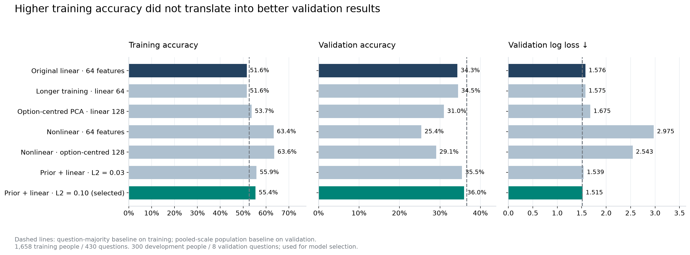

# Artificial Societies — learned survey personas

Build 100 personas from Twin-2K-500 to explore energy-bill relief versus home-energy improvements.

## Run the project

From this folder:

```sh
UV_CACHE_DIR="$PWD/.cache/uv" uv sync --locked
.venv/bin/jupyter lab notebooks/01_download_and_splits.ipynb
```

In VS Code, select `.venv/bin/python` as the notebook interpreter. Python 3.12 and the dependency versions are recorded in `.python-version`, `pyproject.toml` and `uv.lock`.

## What is here

```text
notebooks/        The experiment, explained and executed cell by cell
configs/          Pinned data source and reproducible split rules
data/
  raw/            Unmodified source files and checksums
  processed/      Permitted training responses and persona evidence
  heldout/        Validation/test answers and the repeatability reference
  splits/         Fixed participant IDs, question roles and partition checks
outputs/          Audit reports and question–answer embeddings
```

The notebooks are self-contained; there is no separate Python package or duplicate script entry point. Add reusable model code when training actually needs it. Generated features, models, personas and charts can go under `outputs/` when they exist. `.venv/` and `.cache/` hold local tooling and downloads; they are not project source files.

## Current state

**Final simulation complete.** Start with [the visual report](outputs/final_simulation_report.html) (open the downloaded HTML in a browser). It embeds four charts and a selector for all 100 personas. The final test has now been evaluated using predictions saved beforehand; the model was not changed afterwards.

- **100 personas:** eight-number vectors fitted from 9,198 observed answers to the 92 fixed evidence questions.
- **Final human-answer test:** 46.3% exact accuracy versus 32.3% for the population baseline; log loss 1.301 versus 1.431 across three reserved energy-policy questions. Aggregate distribution error is similar to the baseline, not an improvement.
- **Five new questions:** support for allocating a hypothetical $1bn budget between bill credits and home-energy improvements in 25% steps. Predicted support is 61.1–61.9%, with no credible winning allocation. These questions have no human ground truth.


The dataset is downloaded and the splits are saved. `01_download_and_splits.ipynb` contains the full download/split logic and seed `20261023`. Running it again verifies existing source hashes and reproduces the existing partitions without silently replacing a split.

`02_question_bank.ipynb` builds `data/processed/question_bank.json`: 441 items with original wording, carried instructions, answer mappings and source records. Use each item's `question_text` for model input; `sources` is for provenance. Checks are saved in `outputs/question_bank_audit.json`.

`03_clean_responses.ipynb` joins permitted responses to the question bank and verifies them against the original labelled source. It saves `shared_training_long.parquet`, `development_anchors_long.parquet` and `final_anchors_long.parquet` in `data/processed/`. Each row contains the person/item IDs, full question text, original response code, zero-based answer index and selected answer text. Missing rows remain null; filter `is_missing == False` before fitting. Checks are saved in `outputs/response_cleaning_audit.json`.

`04_data_quality_and_leakage.ipynb` verifies source hashes, participant/question splits, wording and option mappings, clean response tables, held-out file boundaries and potential question overlap. Results and item-level review notes are saved in `outputs/data_quality_leakage_audit.json`. It reads held-out participant IDs and file metadata only, never answer columns. Related predictors remain permitted; no equivalent held-out question was identified in the assistant text review.

`05_question_answer_embeddings.ipynb` loads frozen [Qwen3-Embedding-0.6B](https://huggingface.co/Qwen/Qwen3-Embedding-0.6B) at the revision in `configs/embedding_model.json`. It encodes the complete question context, all options and each candidate answer into 1,877 normalized 1,024-dimensional vectors. No human response tables are loaded.

- `outputs/question_answer_embeddings.npy`: float32 matrix, one row per question/option pair.
- `outputs/question_answer_index.json`: row numbers, item IDs, answer codes/indices, exact input texts and token counts.
- `outputs/question_answer_embedding_audit.json`: model provenance, checksums, execution settings and validation checks.

The vectors and readable index are included in Git. Downloaded model weights remain in the ignored `.cache/` directory and can be retrieved using the pinned config. To retrieve a question, filter the index by `item_id`, sort by `answer_index`, and select those `embedding_row` values from the matrix; the notebook includes an example.

`06_embedding_checks.ipynb` independently reloads the saved features, verifies all 1,877 option lookups, joins all 749,601 observed permitted responses, and reproduces 31 vectors using direct last-token pooling. The fixed training-only paraphrase diagnostic retrieves 9/10 intended options. It narrowly confuses returning all $12 with keeping all $12 in one trust-game example; this is a semantic limitation, not an index mismatch. Findings are in `outputs/embedding_retrieval_checks.json`. These checks do not establish survey prediction accuracy.

`07_pca_and_response_model.ipynb` fits whitened 64-dimensional PCA exclusively on the 1,822 training-option embeddings, then jointly trains the shared scorer and eight-number vectors for 1,658 background respondents. The small model has 13,840 parameters and uses 100 fixed epochs, masked cross-entropy and L2 regularization. Settings are in `configs/response_model.json`; no development/final evidence or validation/test answers are loaded.

- `outputs/question_answer_pca.npz`: training-fitted mean, components, variance scales and fitting-row IDs.
- `outputs/question_answer_features_64.npy`: 64-number features, in the existing option-index order.
- `outputs/shared_response_model.npz`: shared `beta` and `W`, background respondent vectors and their IDs.
- `outputs/shared_response_training.json`: timing, training-fit metrics, learning history, provenance and verification checks.

The notebook verifies saved-file round trips, the scoring equation, masked options and missing answers. Reported accuracy measures training fit, not performance on unseen respondents or questions. The background vectors are not the final 100 personas.

`08_response_model_comparison.ipynb` compares seven small models in two documented rounds. Each shared model uses background people only; each development vector is fitted using the 92 anchor items before scoring the eight validation questions. Selection uses validation log loss. The larger nonlinear models overfit; the selected `prior_linear_l2_01` keeps the linear eight-coordinate model, adds training-derived answer-scale priors and strengthens regularization.

Compared with the original, training accuracy rises from 51.6% to 55.4%, validation accuracy from 34.3% to 36.0%, and policy-validation accuracy from 42.5% to 48.8%. Overall validation log loss falls from 1.5761 to 1.5155. A pooled-scale population baseline still slightly wins overall (36.6% accuracy; 1.5127 log loss). Only eight validation questions were available, and those results were used for selection; they are not an independent final assessment.

- `outputs/selected_response_model.npz`: selected shared weights, background/development vectors, IDs and feature references. Original checkpoint is retained.
- `outputs/question_answer_features_prior_65.npy`: original 64 PCA features plus a fixed log population probability for each option.
- `outputs/response_scale_priors.json`: training-only frequency estimates by answer-scale wording/order; unseen scales default to uniform probabilities.
- `outputs/model_comparison.json`: every candidate, baselines, per-question metrics, provenance and selection rationale.
- `outputs/development_validation_predictions.npz`: selected validation probabilities with person/question IDs.
- `outputs/question_answer_pca_contrast_128.npz` and `outputs/question_answer_features_contrast_128.npy`: alternative features used in the comparison, not the selected model.

`09_model_diagnostics.ipynb` generates four figures with baselines and explicit training/validation labels. PNG and matching PDF exports are in `outputs/figures/`; `outputs/plot_manifest.json` records their source hashes and plotted answer shares.



Other figures: [validation by question](outputs/figures/02_validation_by_question.png), [human versus predicted answer shares](outputs/figures/03_validation_answer_distributions.png), and [original training curves](outputs/figures/04_original_training_curves.png).


`10_respondent_vector_checks.ipynb` holds the selected model fixed and compares correct, mean, zero and shuffled development vectors. Correct vectors outperform shuffled ones (36.0% versus 27.0% accuracy), demonstrating person-specific signal. However, mean/zero vectors reach 36.6% with slightly better log loss: individual variation has not demonstrated an overall benefit. These exploratory checks use existing validation only; no retraining or final-test access. Results and paired respondent-bootstrap intervals are in `outputs/respondent_vector_checks.json`; [vector comparison figure](outputs/figures/05_respondent_vector_checks.png) also has a PDF export.

`11_final_personas_and_simulation.ipynb` fits the final 100 vectors using the existing selected model and anchor-only protocol. It encodes the five new questions with cached, frozen Qwen and the original PCA, saves 500 seeded single-select responses and all probabilities, and seals the predictions before final labels are opened.

`12_final_results.ipynb` evaluates those frozen predictions on the three reserved questions, compares population and zero-vector baselines, and creates the visual report. All four new figures are exported to `outputs/figures/` as PNG and PDF. The final test is now consumed; subsequent model changes need fresh evaluation data.

- `configs/energy_policy_survey.json`: exact common scenario, five questions, options and interpretation.
- `configs/final_simulation_protocol.json`: fixed fitting settings, evaluation metrics and comparators.
- `outputs/final_personas.json`: all 100 persona vectors and permitted answer evidence, linked to the clean question bank.
- `outputs/final_persona_vectors.npz`: compact vectors and person/question IDs.
- `outputs/novel_policy_responses.json`: 500 single-select draws with option probabilities; aggregate figures use mean probabilities.
- `outputs/final_test_predictions.npz` and `outputs/novel_policy_predictions.npz`: frozen predictions and baseline probabilities.
- `outputs/novel_question_index.json`, `novel_question_embeddings.npy`, `novel_question_features.npy`: new-question wording and feature provenance.
- `outputs/final_prediction_seal.json`: pre-evaluation input/output hashes and fit checks.
- `outputs/final_evaluation.json`: final metrics, paired respondent-bootstrap intervals and new-question estimates.
- `outputs/final_figure_manifest.json`: chart hashes; `outputs/final_simulation_report.html`: portable report with embedded images.

Verification: both notebooks executed; 100 vectors and 500 seeded draws checked; new PCA transformation reproduced; frozen source/model hashes unchanged; all four charts visually reviewed. HTML embedded data and JavaScript syntax were checked. Automated browser preview was unavailable because the browser tool blocks local-file URLs.

- **People:** 1,658 shared-training, 300 development, 100 final personas.
- **Questions:** 430 permitted training columns; 92 persona-evidence columns; eight validation questions; three final-test questions.
- **Source/version:** `configs/data_source.json` records the Hugging Face commit and file checksums.
- **Split design:** `configs/data_split_plan.json`; exact assignments are in `data/splits/`.
- **Checks:** `outputs/data_split_audit.json`. `outputs/environment_check.json` retains the initial setup check.

Missing responses remain missing and numeric answers retain their original one-based option positions. Held-out labels were partitioned programmatically, without displaying answers or inspecting response distributions. Raw files still contain them: training must read the permitted `data/processed/` files, not unfiltered raw tables.

Data and output reports are included in Git so reviewers can inspect the source data, fixed splits, prepared tables and checks directly. Notebooks, configuration and the dependency lockfile provide the reproducible recipe. Local environments, caches and credentials remain git-ignored.

## Next

Present the frozen results and validate the five allocation questions with a real human pilot before recommending a budget split. The final test showed improved individual-answer prediction, while aggregate opinion estimates remained comparable to the baseline. New-package differences are small and unvalidated. Any further model tuning requires fresh held-out questions or respondents; do not reuse this final test for selection. Related policy rows share a survey instrument, and public-model pretraining contamination is unknown.

Source: [Twin-2K-500](https://huggingface.co/datasets/LLM-Digital-Twin/Twin-2K-500), Toubia et al. (2025), [paper](https://arxiv.org/abs/2505.17479). Licence: CC BY 4.0.
